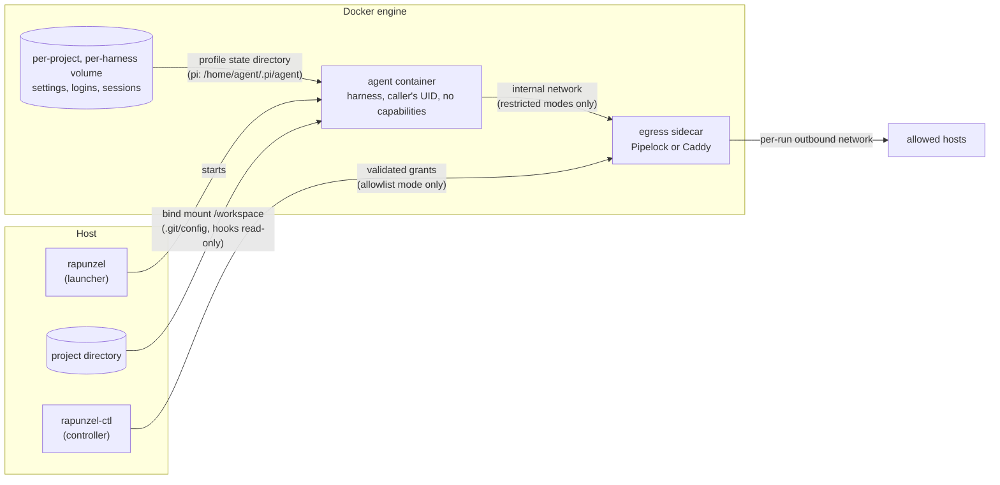

# rapunzel: Architecture

## Abstract

rapunzel runs coding-agent harnesses inside a Docker container that treats the agent as untrusted.
A harness is the command-line agent that drives a model and acts on a project, such as pi or Claude Code.
The pi coding agent is the default harness; Claude Code, Codex CLI, DeepSeek Harness (dsh), and opencode are further profiles, and Copilot CLI is planned.
The agent sees one host directory, the project it works on, and keeps its own settings, logins, and sessions in a separate Docker volume per project and harness.
It runs as the caller's user without root privileges or Linux capabilities, and receives only an allowlist of environment variables.
Two optional egress modes restrict the network: `allowlist` lets the agent reach only named hosts through an SNI-checking HTTPS proxy, and `strict` (pi, opencode, and Claude Code) additionally keeps provider API keys out of the container by placing them in a credential gateway.
In `allowlist` mode, a host-side controller can grant or revoke single hosts while a run is live.
Because an agent can also attack the host indirectly, by writing files that the host later runs, git hooks and git configuration are mounted read-only and changes to other host-executed files are reported after each run.
Every one of these properties is checked by scripts that act as a hostile agent through the real launcher; they run in CI before any image is published.

## Key points

1. **The boundary is outside the agent.** rapunzel does not rely on the agent's own permission prompts or sandbox. Docker, the launcher, and sidecar containers enforce every control, whichever harness runs inside.
2. **One host directory, nothing else.** The project is mounted at `/workspace`. The host home directory, the harnesses' host directories such as `~/.pi` or `~/.claude`, `~/.ssh`, and the Docker socket are never mounted. Agent state lives in a named volume per project and harness.
3. **No privileges.** The agent runs as the caller's numeric UID and GID, with all capabilities dropped and `no-new-privileges` set.
4. **Network access is a choice.** `open` (default) gives normal internet access. `allowlist` gives only named HTTPS hosts, which the operator can extend per run from the host. `strict` (pi, opencode, and Claude Code) gives only fixed provider routes and no real API key, optionally plus named non-provider HTTPS hosts for tools.
5. **The network boundary fails closed.** In both restricted modes the agent sits on a Docker `--internal` network with no route, no external DNS, and no host address. Anything that ignores the proxy has nowhere to go.
6. **The host is protected from planted files.** Git hooks and git configuration are read-only inside the container, so the agent cannot make the host's git run its code. Other host-executed files are reported, not blocked. With `--clone` the agent works on a clone in a volume instead, and nothing it writes reaches the host checkout.
7. **Claims are tested, not assumed.** `verify-isolation.sh`, `verify-host-files.sh`, `verify-workspace.sh`, `verify-egress.sh`, and `verify-control.sh` probe the boundary through the real launcher. CI runs them on every change and before every image release.

## 1 Problem and goals

Coding agents read and write source code, run shell commands, install packages, and talk to model APIs.
They act on instructions that may come from the files they read, so a prompt injection in a dependency's README can turn a helpful agent into a hostile one.
Running such an agent directly on a workstation gives it everything the user has: SSH keys, cloud credentials, browser sessions, other projects, and the local network.

rapunzel aims for the following:

| Goal | Meaning |
|---|---|
| G1: Confinement | The agent can read and write only the project it was started for. |
| G2: No ambient secrets | Host credentials and environment variables do not leak into the container. Only explicitly configured provider settings do. |
| G3: Controlled egress | The user can restrict where the agent connects, up to keeping the provider key itself out of reach. |
| G4: Host integrity | Files the agent writes in the project cannot silently run on the host later. |
| G5: Portability | The same behavior on Linux, Docker Desktop for macOS, Colima, and WSL2. |
| G6: Verifiability | Every isolation claim has an automated check. |

Non-goals: protecting the project's contents from the agent (the agent is meant to edit them), and protecting data the agent legitimately sends to its model provider.

## 2 Threat model

**Trusted:** the host, the Docker engine, the launcher scripts in this repository, and the pinned container images.

**Untrusted:** the agent process, every process it starts, the content of the mounted project, and everything stored in the agent's volume, including its settings, extensions, and logins.

**The attacker** controls the agent, for example through prompt injection, and tries to:

- read host files or credentials outside the project;
- send data to a server of its choice;
- reach the host or the local network;
- gain root or Linux capabilities inside the container;
- plant code that the host runs later, outside the container;
- persist across sessions through the agent's volume.

**Out of scope:** kernel or container-runtime escapes, a compromised Docker engine or host, and the model provider itself.

## 3 System overview



| Component | Role | Source |
|---|---|---|
| `rapunzel` | Launcher on the host. Selects the harness profile, builds the `docker run` command, filters the environment, sets up egress, registers the run, reports host-file changes, resets the terminal. The links `rapunzel-claude`, `rapunzel-codex`, `rapunzel-dsh`, and `rapunzel-opencode` select their profile by name. | `rapunzel`, `lib/*.sh` |
| Harness profile | Data only: command, image, state directory, environment names, egress hosts, and whether `strict` is supported. It never weakens a launcher control. | `profiles/<harness>/profile.sh`, `lib/profile.sh` |
| Image | Shared Debian slim base with Node 24, bash, CA certificates, git, curl, ripgrep, jq, less, zip, unzip, procps, and libnss-wrapper, plus one final stage per harness. The pi image is built from this repository and published to `ghcr.io/koopycat/rapunzel`; the others are built locally with `--target <harness>`. | `Dockerfile` |
| Entrypoint | Maps the caller's UID to the name `agent`, runs the profile's bootstrap to write the harness's configuration, then runs the requested command. | `bootstrap.sh`, `setup-identity.sh`, `profiles/<harness>/bootstrap.mjs` |
| Agent volume | Docker named volume per project and harness, mounted at the profile's state directory (pi: `/home/agent/.pi/agent`). | `lib/volumes.sh` |
| Egress sidecar | Pipelock (allowlist mode) or Caddy (strict mode), created per run. | `lib/egress.sh` |
| `rapunzel-ctl` | Host-side controller: lists live runs, shows their redacted policy and blocked events, and grants or revokes hosts in `allowlist` mode. | `rapunzel-ctl`, `lib/control.*`, `lib/runs.sh` |
| `rapunzel-ext` | Copies curated extensions from the host into a project's volume. | `rapunzel-ext` |
| Check scripts | Probe the boundary through the real launcher. | `test.sh`, `test-control.sh`, `verify-*.sh` |

**One run, step by step:**

1. `rapunzel` selects the harness profile (`--harness`, the link name, or `RAPUNZEL_HARNESS`; default pi), resolves the project directory (default: the current directory), and refuses to run as root.
2. Without `RAPUNZEL_ENV_FILE`, it uses `~/.config/rapunzel/<harness>.env` when that file exists.
3. It checks that the Docker engine is reachable and explains how to start one if not. A missing harness image is built from the checkout's `Dockerfile`.
4. It prepares the volume's ownership for the caller's UID in a short-lived, networkless container, and registers the run under a new run ID in the caller-owned host directory `~/.local/state/rapunzel/runs`.
5. It filters the environment and the env file through an allowlist.
6. In a restricted egress mode it creates two networks and the sidecar, and waits until the sidecar is healthy.
7. It records hashes of host-executed files in the project.
8. It runs the agent container. The entrypoint sets up the identity, runs the profile's bootstrap, then starts the harness, or a shell with `--shell` or a command with `--exec`.
9. When the container exits, it removes the sidecar, networks, and run record, resets terminal modes the harness may have left on, and reports changed host-executed files.

## 4 Design

### 4.1 Process and filesystem isolation

The agent container starts with `--user <caller UID>:<caller GID>`, `--cap-drop=ALL`, `--security-opt=no-new-privileges`, `--init`, and a process limit of 4096 (`RAPUNZEL_PIDS_LIMIT`), so a fork bomb cannot exhaust the Docker VM; a memory limit applies only when `RAPUNZEL_MEMORY` is set.
It has exactly two intentional mounts, plus the read-only git sub-mounts of section 4.6:

```text
PROJECT_DIR (read-write)               -> /workspace
per-project, per-harness named volume  -> profile state directory (pi: /home/agent/.pi/agent)
```

In clone mode (section 4.7) there is no bind mount at all: `/workspace` is a volume.
The project mount uses the caller's own UID, so files the agent creates belong to the user on the host.
Nothing else from the host is mounted.
In particular the harnesses' host directories, such as `~/.pi`, `~/.claude`, and `~/.codex`, stay out: they hold credentials, trust decisions, extensions that run code, and full session history from every project.

The launcher publishes no ports.
The one exception is a profile with a web UI (dsh) started with its default arguments in `open` mode: one port, bound to the host's `127.0.0.1` only, with the harness's own authentication left on.

### 4.2 Identity without root

The container runs as an arbitrary UID that has no entry in `/etc/passwd`, which breaks shell prompts, `whoami`, and Node's `os.userInfo()`.
Adding an entry would need root at runtime.
Instead, `setup-identity.sh` writes a private passwd and group file into the agent volume and preloads libnss-wrapper, which maps the current UID to the name `agent`.
`LD_PRELOAD` is always set to exactly that library; an inherited value is discarded.

`/home/agent` and `/home/agent/.pi` are world-writable with the sticky bit, like `/tmp`, because the runtime UID is the caller's and not the image's build user.
Tools and extensions write caches there, for example `~/.pi/cache`.
The image also marks `/workspace` as a safe git directory, because Docker Desktop presents the mount root as owned by root and git would otherwise refuse the repository.

### 4.3 Agent state and configuration

Each project gets its own volume, named `rapunzel-<harness>-` plus the first 12 hex digits of the SHA-256 of its canonical path.
Settings, logins made inside the sandbox, sessions, trust decisions, and installed extensions therefore never mix between projects or harnesses.
`RAPUNZEL_VOLUME` opts into a shared volume deliberately.

A new volume is owned by root.
Before every run, a short root container with only `CHOWN` and `DAC_OVERRIDE`, and no network, hands it to the caller's UID.
A marker file records the owner, so later runs only read it.

The entrypoint runs the profile's bootstrap on every start.
pi's rewrites `models.json` and `settings.json`: it registers a custom provider from `RAPUNZEL_*` variables, points built-in providers at the credential gateway in strict mode, and removes those overrides again in other modes.
opencode's builds the same custom provider in a rapunzel-owned config file and never edits the user's `opencode.json`.
Claude Code's skips the login picker when a credential is set and, in strict mode, writes Claude Code's gateway settings into the `env` block of `settings.json`, and Codex's defaults `sandbox_mode` to `danger-full-access` because Codex's own bubblewrap sandbox cannot run in the container; values the user sets win.
Because the managed entries are rewritten each time, an edit the agent makes to them does not persist.

### 4.4 Environment and credentials

The container never inherits the host environment.
`rapunzel` forwards only names on an allowlist: known provider keys, proxy variables, and the profile's own names, such as pi's `RAPUNZEL_*` provider settings or Claude Code's `CLAUDE_CODE_OAUTH_TOKEN`.
A profile's names reach only that harness.
A denylist (`LD_PRELOAD`, `NODE_OPTIONS`, `BASH_ENV`, `PATH`, `HOME`, the state-directory variable, and similar) wins over everything, so neither the host nor an env file can inject loader or interpreter hooks.
The env file, `RAPUNZEL_ENV_FILE` or the default `~/.config/rapunzel/<harness>.env`, passes through the same filter; dropped names are reported.
`TZ` is set from the host when it is a plain zone name.

Secrets reach the container only at runtime, never through the image.
How far they reach depends on the egress mode (section 4.5): in `open` and `allowlist` the agent holds the key it uses; in `strict` it holds a placeholder.

### 4.5 Network egress

`RAPUNZEL_EGRESS` selects one of three modes.

| Mode | Agent holds the provider credential | Agent can reach |
|---|---|---|
| `open` (default) | yes | the internet through Docker's `bridge` network |
| `allowlist` | yes | only allowlisted hosts over HTTPS |
| `strict` (pi, opencode, Claude Code) | no, only a placeholder | only fixed provider routes on a credential gateway, plus, with `RAPUNZEL_EGRESS_ALLOW`, the listed non-provider hosts over HTTPS |

Both restricted modes also set the harness's offline switches, for example `PI_OFFLINE` or `DISABLE_AUTOUPDATER`, because vendor update and telemetry hosts are unreachable.

**The network layer.**
Both restricted modes create two networks per run.
The agent joins only the first: an `--internal` network in isolated gateway mode (Docker Engine 28 or newer).
It has no route off the network, no external DNS, and no address on the host side of the bridge.
The sidecar joins this network and a second, per-run outbound bridge.
It never joins Docker's default bridge, so even a compromised sidecar cannot reach the user's other containers.
Isolated gateway mode is not optional: in testing, a listener on the host network was reachable from a plain internal network.

**allowlist mode.**
The sidecar is [Pipelock](https://github.com/luckyPipewrench/pipelock) acting as an HTTPS CONNECT proxy.
The agent gets `HTTPS_PROXY` and `NODE_USE_ENV_PROXY=1`, and no `HTTP_PROXY`, so cleartext requests fail.
For every tunnel, Pipelock checks the requested host against the allowlist, requires the TLS ClientHello's server name (SNI) to match it, resolves the name itself, and refuses private, loopback, link-local, and metadata addresses.
The SNI check matters: without it, a tunnel to an allowed host on a shared CDN can reach any other site on that CDN.
Squid and Smokescreen failed exactly this test.

The allowlist is built only from settings on the host:

| Setting | Allowed host |
|---|---|
| Harness profile | its own model API (Claude Code: `api.anthropic.com`, dsh: `api.deepseek.com`) |
| A built-in provider key (`ANTHROPIC_API_KEY`, `OPENAI_API_KEY`, `OPENROUTER_API_KEY`, `GEMINI_API_KEY`, `GROQ_API_KEY`, `MISTRAL_API_KEY`, `DEEPSEEK_API_KEY`, `XAI_API_KEY`) | that provider's API host |
| `RAPUNZEL_API_BASE_URL` | that URL's host |
| `RAPUNZEL_EGRESS_LOGINS` | model API and token refresh hosts of named `/login` providers |
| `RAPUNZEL_EGRESS_ALLOW` | listed hosts; `*.example.com` also matches `example.com` |
| `RAPUNZEL_EGRESS_ALLOW_PRIVATE` | exact hosts that may resolve to private addresses, such as a model router on the LAN |
| `rapunzel-ctl egress allow RUN_ID HOST` | an exact host for the rest of that run |

It is never read from `auth.json` or anything else in the volume, because the agent can write there and would otherwise choose its own allowlist.

**strict mode.**
The sidecar is a Caddy reverse proxy that holds the real keys.
The bootstrap points the harness at `http://llm-proxy:8080` (pi's and opencode's providers, Claude Code's `ANTHROPIC_BASE_URL`), and the agent holds the placeholder `rapunzel-gateway`.
For Claude Code the `/anthropic` route can also carry a host-issued subscription token from `claude setup-token`, set as `Authorization: Bearer`.
Caddy forwards only one route per built-in provider with a key (`/anthropic`, `/openai`, `/openrouter`, `/google`, `/groq`, `/mistral`, `/deepseek`, `/xai`) and `/custom` to fixed upstreams, always overwrites the auth headers with the real key, drops a `key` query parameter, and answers everything else with 403.
Overwriting rather than swapping a placeholder matters: it stops the agent from using an allowed provider with an attacker's key to send data out.
OAuth logins made inside the sandbox cannot use this mode, because the harness refreshes those tokens itself and keeps them in the volume.
Codex and dsh do not support `strict` yet, and the launcher refuses it for them.

**strict mode with a tool allowlist.**
`RAPUNZEL_EGRESS_ALLOW` in strict mode starts Pipelock next to the gateway, configured as in allowlist mode, so tools can install packages or clone repositories while the provider key stays out.
An entry that covers a provider's API host is refused at startup, so the agent still cannot reach a provider except through the gateway ([D17](egress.md#d17-strict-mode-with-a-tool-allowlist)).

**Extension providers.**
A provider can come from a pi extension that reads its own variables, for example `OMNIROUTE_BASE_URL` and `OMNIROUTE_API_KEY`.
`RAPUNZEL_BASE_URL_VARIABLE` and `RAPUNZEL_API_KEY_VARIABLE` name them.
`rapunzel` fills in the real URL and key in `open` and `allowlist` mode, and the gateway route and placeholder in `strict` mode.

The full reasoning, including rejected alternatives and test evidence, is in [Egress control: architecture and decisions](egress.md).

**Runtime control.** `rapunzel-ctl` lists verified registry-backed live runs and inspects their redacted policy. Unique run prefixes resolve to a frozen full ID; mutations revalidate under the update lock. Text on terminals and JSON in pipes both escape untrusted strings. Grouped blocked-event snapshots show current policy coverage, not held requests or confirmed connectivity. `config` calls the launcher's own policy construction without starting Docker. In `allowlist` mode, operators may add exact host allowances for a selected run and revoke only those added allowances. Authoritative metadata lives in a caller-owned `0700` host directory outside `/workspace`, never in the agent's volume. The controller validates a staged configuration with a networkless instance of the pinned sidecar image and commits only after a fresh live reload event acknowledges the expected hash. Transaction evidence is independent of the bounded diagnostic history. Atomic replacement uses a separate networkless helper; no host bind mount, control port, or Docker socket enters the workload. The controller owns signal cleanup. An uncertain reload/rollback attempts sidecar shutdown, verifies it before reporting success, and reports unconfirmed shutdown explicitly. Grants do not bypass private-address protection, persist to future runs, or close existing tunnels on revoke. Strict-mode routing is unchanged. See [D14](egress.md#d14-host-only-per-run-destination-grants-with-confirmed-reload) and the [runtime guide](guide.md#runtime-egress-control).

### 4.6 Files the host runs

Network controls do not help if the agent writes a git hook and the user then runs `git commit` on the host.
rapunzel handles this in two layers.

**Prevention for git.**
`.git/config`, `.git/hooks`, and a `core.hooksPath` directory inside the project (such as `.husky`) are mounted read-only on top of the project mount.
The agent can still commit, branch, and stash; it cannot add a hook, set `core.fsmonitor`, or change `core.hooksPath`.
`.git` itself is first bind-mounted onto its own path.
Read-only sub-mounts move with their parent directory, so without this the agent could rename `.git` and create a new one with its own config and hooks, which the host's git would then use.
A mount point cannot be renamed, so the rename fails.
A symlinked `.git/config` or `.git/hooks` would dangle inside the container and could be replaced there, so the launcher refuses to start instead.
Linked worktrees and submodules keep their git directory outside the project, so it is not mounted at all.

**Detection for everything else.**
Before the agent starts, `rapunzel` hashes files that common host tools run on their own: `.envrc`, editor tasks and settings, JetBrains run configurations, devcontainer and CI configuration, pre-commit and husky hooks, agent settings and project-local agent resources (`.pi`, `.agents`, Claude Code commands, agents, skills, and hooks), package manifests and scripts, Cargo configuration and a top-level `build.rs`, Makefiles, Nix and devenv files, and the writable parts of `.git`.
When the agent exits, it lists every such file that was added, modified, or removed.

The trade-off is deliberate: making the whole `.git` read-only would stop the agent from committing. The clone workspace (section 4.7) removes host write access entirely for users who can do without untracked files.

### 4.7 Clone workspace

With `--clone` (`RAPUNZEL_WORKSPACE=clone`), `/workspace` is the `repo/` subpath of a per-project, per-harness volume holding a git clone, and the agent container has no host bind mount at all.
History moves only as git bundles over stdin and stdout of a short-lived helper container from the harness image, with no network, no capabilities, the caller's UID, and only the workspace volume:

- Before each run, the host's own git bundles the host's branches and tags; the helper clones them on the first run and afterwards only updates `refs/remotes/origin/*` and tags, so the agent's branches and working tree are untouched. Bundles are incremental after the first run; a ref list sent along with the bundle covers refs that moved without new objects.
- After each run, the helper bundles the workspace's branches. The host validates the object IDs and ref names it receives, fetches the bundle with `transfer.fsckObjects`, and writes only `refs/remotes/rapunzel-<harness>/*`. It never runs git inside the workspace repository or reads its configuration, so hooks, `core.fsmonitor`, and tags set there stay there.
- The host prints the new commits per branch, flags commits that touch a host-executed path (the list of section 4.6), and reports uncommitted work left in the volume. Text from the workspace is stripped of terminal control characters first.

The helper's git does run in the agent-controlled repository; it overrides `core.fsmonitor` and `core.hooksPath`, and anything else the repository config triggers stays inside the networkless helper and the volume.
Uncommitted host changes, untracked files, submodules, and LFS objects are not copied.

### 4.8 Operational details

- **Docker reachability.** All scripts check that the Docker engine responds before their first Docker call. If not, they print the original error, the active context or `DOCKER_HOST`, and how to start an engine or switch contexts.
- **Terminal reset.** pi switches on the kitty keyboard protocol, mouse and focus reporting, and since version 1.0 a fullscreen alternate screen. If its own restore is lost, for example when the container is killed, the shell would receive keys as escape sequences. After every interactive session `rapunzel` pops the keyboard protocol stack, switches those modes off, and leaves the alternate screen.
- **Releases.** Renovate tracks pi, the other harness CLIs, the sidecar images, GitHub Action SHAs, and the base image. pi patch updates merge on their own after one day of release age once CI passes; pi minor and major updates wait for review. The other harness CLIs arrive as one weekly PR and the sidecar images as another, both reviewed by hand. The two sidecar images are pinned by digest and never merged automatically.

## 5 Verification

| Script | What it proves | Network |
|---|---|---|
| `test.sh` | The harness (pi by default, any profile with `RAPUNZEL_HARNESS`) starts through the real entrypoint; the identity maps to `agent`; `HOME` and the state directory are writable by the caller's UID; the bootstrap writes its configuration without putting keys in the volume; pi's sessions stay in the volume and its TypeScript loader works after platform pruning. | none |
| `test-control.sh` | Host only, no Docker: configuration inspection never starts Docker, the run registry is caller-owned and refuses symlinks, grant targets are validated, and blocked-event output is escaped and grouped correctly. | none |
| `verify-isolation.sh` | The process is not root; `/workspace` and the volume are writable; host paths (`/Users`, `/Volumes`, host home, `~/.ssh`, `~/.pi`) are not visible; the mount table has no host home mount. | none |
| `verify-host-files.sh` | Writing git hooks, git config, and `core.hooksPath` hooks fails; moving `.git` aside fails; a commit still works; planted `.envrc`, editor tasks, and git attributes are reported. | none |
| `verify-workspace.sh` | In clone mode the agent container has no bind mount; host commits arrive as `origin/*` without moving agent branches; agent commits reach the host only under `refs/remotes/rapunzel-pi/*`; planted hooks, git config, and tags stay in the workspace; terminal escapes in commit text are stripped; a commit adding `.envrc` is flagged. | none |
| `verify-egress.sh strict` | No external DNS, direct IPv4/IPv6, metadata, or host access; the upstream is reachable only through the gateway; unknown routes get 403; the real key never reaches the agent; the agent's own credentials are replaced. | none |
| `verify-egress.sh allowlist` | The same network checks; an allowed host works; other hosts, IP literals, a mismatched or missing SNI, plaintext tunnels, and plain HTTP are refused; private hosts need `RAPUNZEL_EGRESS_ALLOW_PRIVATE`; an Encrypted Client Hello is reported as the known gap until the pinned Pipelock refuses it. | internet |
| `verify-control.sh` | Runtime grants through the real launcher and pinned Pipelock: allow and revoke take effect for new tunnels, SNI binding still holds after a policy change, concurrent operators keep each other's grants, a broken candidate is rejected before the live policy changes, a lost acknowledgement stops egress instead of reporting success, and the workload sees no policy state or Docker control channel. | internet |

The egress probe runs inside the agent container through `rapunzel --exec`, so it tests the launcher's actual configuration rather than a copy of it.
A listener on the host network serves as a canary: reaching it would mean the host is reachable.

`ci.yml` runs ShellCheck and every script on each pull request that changes more than documentation; it builds and smoke-tests the other harness images only when the `Dockerfile`, entrypoint, or profiles change.
`publish-image.yml` calls the same workflow and publishes the multi-architecture image (`linux/amd64`, `linux/arm64`) only after it passes.

Tested platforms: Docker Engine 28 on Ubuntu (CI), Colima with Docker Engine 29 on macOS, and Docker Desktop 29 on macOS. Docker Desktop has a known problem with the read-only git mounts (section 8). WSL2 has not been tested yet.

## 6 Security analysis

**What the design guarantees**, given a correctly working Docker engine:

- The agent cannot read host files outside the project, because nothing else is mounted.
- The agent has no root and no capabilities, and cannot gain either through setuid binaries.
- Host environment variables and credentials reach the agent only by explicit configuration.
- In both restricted modes, the agent cannot open a network connection except to the sidecar, and cannot resolve external names.
- In `allowlist` mode, it reaches only allowlisted hosts, with a TLS handshake that names that host.
- In `strict` mode, it never sees the real API key, and cannot use an allowed provider with a key of its own.
- It cannot make the host's git run code it wrote.

**Residual risks**, ranked:

1. **Host-executed files outside git (high).** In mount mode, changes to `.envrc`, editor tasks, or package scripts are reported, not blocked. A user who ignores the report and runs these tools is exposed. Clone mode removes the direct path; a merged agent commit can still bring such a file in, which the review report flags.
2. **Data sent through allowed hosts (high).** The agent can send anything it reads to the hosts it may reach, under the user's key. In `allowlist` mode it can also use an attacker's key on an allowed provider; `strict` mode prevents that. Every added host, including a runtime grant, widens this channel. With a `/login` subscription, a leaked refresh token stays valid after the session.
3. **Encrypted Client Hello (medium, confirmed at the proxy).** With ECH, the outer SNI can name an allowed host while the inner one names another site on the same CDN. `verify-egress.sh` shows that the pinned Pipelock forwards such a ClientHello; whether a given CDN then routes on the inner name is not tested. Pipelock offers no setting to refuse it, and rapunzel does not patch Pipelock ([D16](egress.md#d16-encrypted-client-hello-is-measured-not-refused)).
4. **Agent-volume tampering (medium).** Extensions, settings, and trust decisions persist in the volume and run again in the next session.
5. **Sidecar compromise (medium).** A compromised sidecar has full egress, limited to the internet by its per-run outbound network.
6. **Dependency supply chain (low for pi, medium for other harnesses).** pi's whole dependency tree is locked with integrity hashes in `profiles/pi/package-lock.json`, so a build cannot pick up a newly published malicious version; a compromised version that was already locked in stays a risk until it is noticed. The other harnesses still resolve their dependencies at build time.
7. **Kernel or runtime escape (low likelihood, high impact).** On Linux this reaches the host; on Docker Desktop and Colima it reaches the VM.

## 7 Design decisions and alternatives

| Decision | Alternative rejected | Reason |
|---|---|---|
| Run as the caller's UID | Fixed UID 1001 | Files created in the project must belong to the user; a fixed UID breaks writes on Linux. |
| libnss-wrapper for the user name | Add a passwd entry at runtime | Needs root; nss_wrapper works unprivileged. |
| Per-project named volume | Mount the host `~/.pi` | The host directory holds credentials, code-running extensions, and every project's history. |
| Sidecar on an internal network | Host firewall rules, iptables inside the container, transparent proxy | Only this works the same on Linux, Docker Desktop, Colima, and WSL2, and it fails closed ([D1](egress.md#d1-egress-control-through-a-sidecar-on-an-internal-network)). |
| Pipelock for `allowlist` | Squid, Smokescreen, tinyproxy | Only Pipelock refused a tunnel whose SNI differed from the CONNECT host ([D4](egress.md#d4-pipelock-as-the-allowlist-proxy)). |
| Caddy for `strict` | iron-proxy, agent-vault, agentgateway, nginx, Envoy | Verifies upstream TLS by default, keeps secrets out of its config, needs no CA in the agent; the dedicated tools let a second auth header through ([D6](egress.md#d6-caddy-for-strict-mode)). |
| Allowlist from host settings only | Detect logins from `auth.json` | The agent can write `auth.json` and would widen its own allowlist ([D11](egress.md#d11-login-providers-are-named-on-the-host)). |
| Read-only git control files plus a report by default, a clone workspace on request | Whole `.git` read-only | Keeps commits working in mount mode; the clone workspace (section 4.7) trades untracked files and live edits for no host write access. |

## 8 Limitations and future work

- **Docker Desktop and nested mounts.** On Docker Desktop 4.93 for macOS, the virtual machine shut down twice shortly after containers with the read-only git sub-mounts. The same mounts work on Colima and Linux. The cause is not confirmed. The clone workspace (`--clone`) uses no bind mount and avoids them.
- **WSL2** has not been tested.
- **Other harnesses.** Claude Code is a profile (`profiles/claude`) with `open`, `allowlist`, and `strict` egress; in strict mode its bootstrap writes Claude Code's documented LLM-gateway settings (base URL plus placeholder) into the volume's `settings.json` ([D15](egress.md#d15-claude-code-through-the-credential-gateway)). Codex CLI is a profile (`profiles/codex`) with `open` and `allowlist` egress; its own bubblewrap sandbox cannot run in the container, so it runs with `sandbox_mode = "danger-full-access"` inside rapunzel's boundary. DeepSeek Harness is a profile (`profiles/dsh`) whose default command is a web UI: the launcher publishes it on the host's `127.0.0.1` only, in `open` mode only, because Docker cannot publish ports from the `--internal` network of the restricted modes; reaching it through the sidecar would lift that limit. opencode is a profile (`profiles/opencode`) with `open` and `allowlist` egress; it has no single home variable, so its image points the four XDG base directories into the volume and the profile leaves `H_STATE_ENV` empty. Its bootstrap turns pi's custom-provider variables into an opencode provider, listing the endpoint's models at startup, in a rapunzel-owned file that the image loads through `OPENCODE_CONFIG`; the user's own `opencode.json` is never edited, and the key appears only as an `{env:...}` reference. In `strict` mode the same file points the custom provider and the built-in `anthropic` and `openai` providers at the credential gateway with the placeholder key, so opencode, like pi, never holds a real key. Copilot CLI would plug into the same launcher as a further profile. Copilot needs `api.github.com`, which exposes GitHub's whole API, so it should be opt-in.
- **Reproducible builds.** pi's dependency tree is locked; the other harnesses could use the same lockfile pattern.

## Appendix A: Configuration reference

| Variable | Purpose |
|---|---|
| `RAPUNZEL_HARNESS` | Harness profile (default `pi`); `--harness` or a `rapunzel-<harness>` link does the same. |
| `RAPUNZEL_IMAGE` | Image to run (default: the profile's image, `rapunzel` for pi, `rapunzel:<harness>` otherwise). |
| `RAPUNZEL_VOLUME` | Use a named volume instead of the per-project one. |
| `RAPUNZEL_WORKSPACE` | `mount` (default) or `clone`; `--clone` does the same. |
| `RAPUNZEL_ENV_FILE` | Env file with provider settings and secrets; filtered by the allowlist (default `~/.config/rapunzel/<harness>.env` when it exists; empty for none). |
| `RAPUNZEL_NETWORK` | Docker network for `open` mode (default `bridge`; `none` for offline). |
| `RAPUNZEL_PORT` | Host port for a harness web UI on `127.0.0.1` (dsh, default 3080). |
| `RAPUNZEL_RUNS_DIR` | Host-only run metadata for `rapunzel-ctl` (default `~/.local/state/rapunzel/runs`). |
| `RAPUNZEL_PIDS_LIMIT` | Process limit for the agent container (default 4096, at least 64). |
| `RAPUNZEL_MEMORY` | Memory limit for the agent container, such as `8g` (default none, at least `64m`). |
| `RAPUNZEL_EGRESS` | `open`, `allowlist`, or `strict`. |
| `RAPUNZEL_EGRESS_ALLOW` | Extra hosts for `allowlist`. |
| `RAPUNZEL_EGRESS_LOGINS` | `/login` providers for `allowlist`: `openai`, `openai-codex`, `anthropic`, `github-copilot`. |
| `RAPUNZEL_EGRESS_ALLOW_PRIVATE` | Exact hosts for `allowlist` that resolve to private addresses. |
| `RAPUNZEL_PROVIDER`, `RAPUNZEL_MODEL`, `RAPUNZEL_API`, `RAPUNZEL_API_BASE_URL` | Custom OpenAI- or Anthropic-compatible provider. |
| `RAPUNZEL_API_KEY_VARIABLE` | Name of the variable holding the custom provider's key. |
| `RAPUNZEL_BASE_URL_VARIABLE` | Name of the variable an extension provider reads its endpoint from. |

The [guide](guide.md) explains each setting with examples.

## Appendix B: Source map

| File | Responsibility |
|---|---|
| `rapunzel` | Launcher: arguments, environment filter, egress setup, mounts, run, cleanup. |
| `lib/volumes.sh` | Per-project volume names and ownership preparation. |
| `lib/egress.sh` | Per-run networks, Pipelock and Caddy sidecars, allowlist construction. |
| `rapunzel-ctl`, `lib/control.{sh,jq}`, `lib/ctl-output.{sh,jq}`, `lib/runs.sh`, `lib/policy.sh` | Host-side run discovery, safe text/JSON, grouped history, shared startup policy, and confirmed runtime grants. |
| `lib/host-files.sh` | Read-only git mounts, snapshots, and the change report. |
| `lib/workspace.sh` | Clone workspace: helper container, bundles in both directions, ref validation, and the review report. |
| `lib/docker.sh` | Docker reachability check and building a missing harness image. |
| `Dockerfile`, `lib/prune-foreign-platforms.mjs` | Image: shared base stage, then one final stage per harness (pi is the default); foreign-platform binaries pruned in the install layer. |
| `bootstrap.sh`, `setup-identity.sh`, `rapunzel-shell` | Entrypoint: identity, then the harness's bootstrap script, then the harness or a shell. |
| `profiles/<harness>/profile.sh`, `profiles/<harness>/bootstrap.mjs`, `lib/profile.sh` | Harness profile: command, state directory, environment names, egress hosts, bootstrap. Data only; the launcher enforces everything. |
| `rapunzel-ext` | Curated extensions from the host into a project's volume. |
| `test.sh`, `test-control.sh`, `verify-isolation.sh`, `verify-isolation-inner.sh`, `verify-host-files.sh`, `verify-workspace.sh`, `verify-egress.sh`, `verify-control.sh`, `lib/egress-probe.mjs` | Checks. |
| `docs/egress.md` | Egress decision records and evidence. |
| `docs/guide.md` | User guide. |
